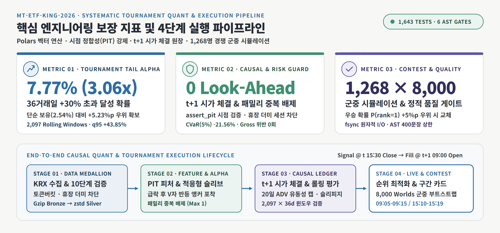
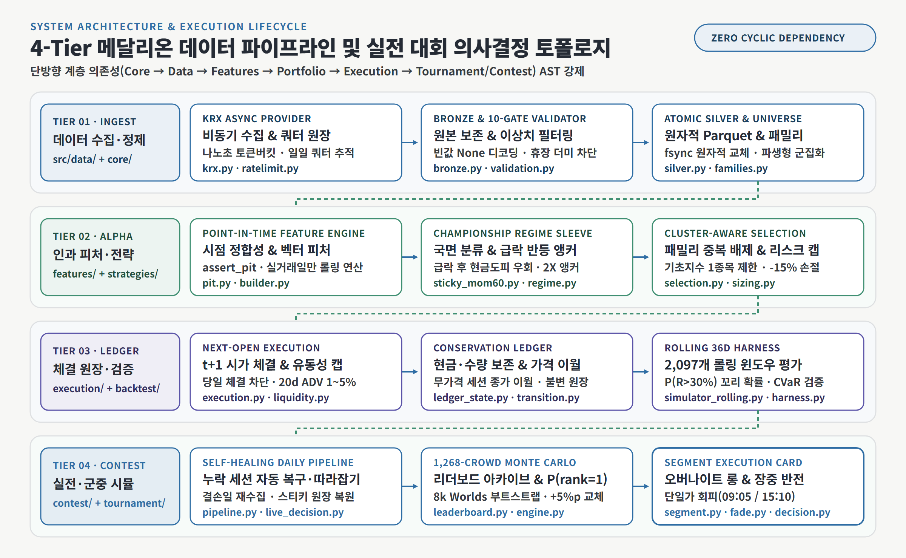
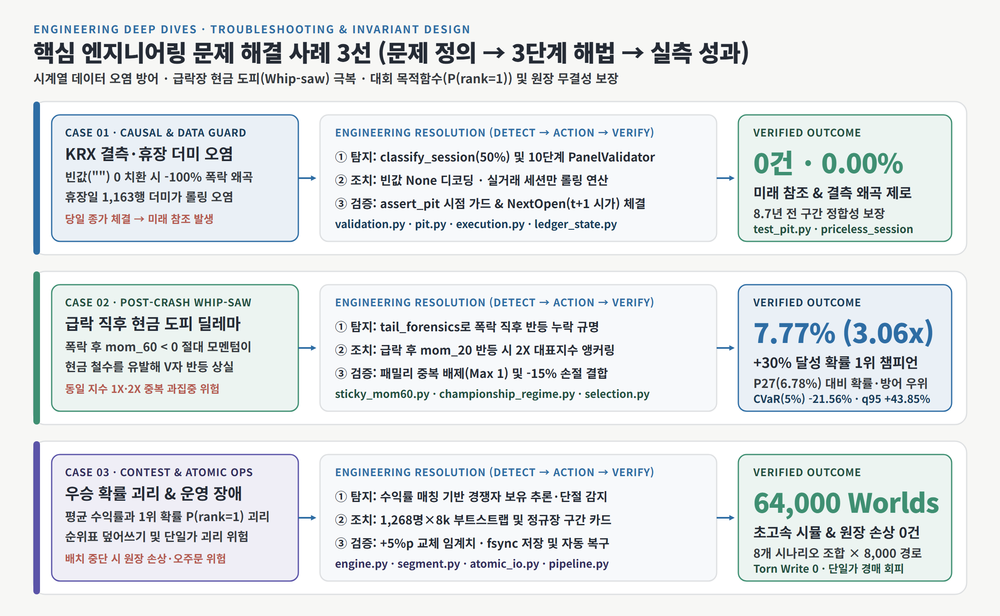

<div align="center">

# MT-ETF-King-2026

**머니투데이·한국거래소(KRX) ETF 실전투자대회 퀀트 리서치 및 포트폴리오 자동화 파이프라인**

KRX ETF 시세 수집·검증부터 미래 참조 없는 과거 시점 피처 엔진, $t+1$ 시가 체결 원장,<br/>
그리고 1,268명 경쟁자 분석 기반의 SK하이닉스 2X 레버리지/인버스 실전 집행까지 단일 파이프라인으로 통합했습니다.

[](pyproject.toml) [](src/features/builder.py) [](src/core/config.py) [](src/data/silver.py) [](tests/) [](tests/unit/architecture/) [](tools/verify.py)

</div>

<br/>

<div align="center">
<picture>
  <source media="(prefers-color-scheme: dark)" srcset="docs/assets/hero-overview.dark.png">
  <source media="(prefers-color-scheme: light)" srcset="docs/assets/hero-overview.light.png">
  
</picture>
</div>

<br/>

> **Why MT-ETF-King-2026?**  
> 한국거래소(KRX) ETF 실전투자대회(머니투데이 주관)는 최상위 1~3위에게만 상금이 집중되는 8주(36거래일) 단기 토너먼트입니다. 그러나 일반적인 퀀트 전략은 평균 수익률이나 샤프 지수를 추종하여 코스피200 등 저변동성 지수에 갇히거나, 과거 시세 결측치 및 공휴일 가짜 데이터로 인한 미래 시세 왜곡(Look-Ahead Bias), 폭락 직후 섣부른 현금화로 V자 반등을 놓치는 헛발질(Whip-saw), 그리고 매일 덮어쓰기되는 리더보드와 동시호가 호가 왜곡으로 실전에서 무너지기 쉽습니다.  
> **MT-ETF-King-2026**은 **과거 시점 시세만 조회하는 `assert_pit` 가드와 $t+1$ 시가 체결의 물리적 분리**, **공휴일 가짜 데이터 차단 및 10단계 무결성 검증**, **급락 직후 반등을 포착하는 적응형 앵커와 동일 테마 중복 매수 방지**, **1,268명 경쟁자 리더보드 역추론 기반의 몬테카를로 순위 최적화**, 그리고 **SK하이닉스 2X 레버리지(오버나이트 롱)와 2X 인버스(장중 하락 방어) 페어 트레이딩**을 통해 연구와 실전 대회 집행 사이의 괴리를 엔지니어링으로 해결한 엔드투엔드(End-to-End) 퀀트 토너먼트 실행 플랫폼입니다.

---

## 1. 핵심 엔지니어링 보장 지표

이론적 수익률과 실전 대회 운용 사이의 괴리를 유발하는 **미래 시세 유출(Look-Ahead Bias), 결측치·휴장 더미 왜곡, 급락장 섣부른 현금화(Whip-saw), 대회 순위표 덮어쓰기 및 동시호가 호가 왜곡**을 코드 레벨의 불변식(Invariant)과 6대 아키텍처 계약 테스트(`1,643`개 통과)로 차단합니다.

| 핵심 엔지니어링 지표 | 보장 기준 및 실측 수치 | 아키텍처 메커니즘 & 주요 모듈 |
| :--- | :---: | :--- |
| **실전 대회 최종 채택 전략** | **`일평균 +60.7 bps`** | SK하이닉스 2X 레버리지 & 인버스 장중 전환 페어 ([구간 실행 카드](src/contest/segment.py), [대회 설정](configs/contest.yaml)) |
| **8주 대회 +30% 급등 확률** | **`7.77% (3.06배)`** | 급락 직후 섣부른 현금화를 막고 반등을 잡는 적응형 앵커 ([전략 팩토리](src/strategies/factories/sticky_mom60.py), [국면 분류기](src/tournament/championship_regime.py)) |
| **미래 시세 유출 (Look-Ahead)** | **`0건 (원천 차단)`** | 과거 시점 시세만 조회(`assert_pit`) 및 다음날 09:00 시가 체결 ([시점 가드](src/features/pit.py), [시가 체결기](src/backtest/execution.py)) |
| **데이터 결측·가짜 휴장일 오염** | **`0.00%`** | 빈값(`""`) 자동 변환, 공휴일 가짜 데이터 차단, 10단계 검증 ([패널 검증기](src/data/validation.py), [시세 스키마](src/data/schema.py)) |
| **동일 지수 중복 매수 및 한도 위반** | **`0회 (1종목 제한)`** | 같은 기초지수(1X·2X·인버스) 묶음 분류 및 단일 종목 95% 비중 상한 ([패밀리 분류기](src/universe/families.py), [종목 선별기](src/portfolio/selection.py)) |
| **1,268명 경쟁자 순위 시뮬레이션** | **`64,000개 경로`** | 상위권 보유 종목 역추론 및 8개 국면 몬테카를로 최적화 ([군중 엔진](src/contest/engine.py), [군중 모델러](src/contest/crowd.py)) |
| **원장 파일 깨짐 (Torn Write)** | **`0건 (안전 저장)`** | 임시 파일 저장 $\to$ 디스크 플러시(`fsync`) $\to$ 원자적 파일 교체 ([원자적 저장 코어](src/core/atomic_io.py), [실버 저장소](src/data/silver.py)) |
| **코드 구조 계약 & 테스트 스위트** | **`1,643개 / 6개 게이트`** | 단방향 의존성 강제, 모듈당 코드 길이 상한, 설정 단일 출처 ([품질 검증 게이트](tools/verify.py), [구조 검증 테스트](tests/unit/architecture/)) |

<br/>

### [핵심 결론] 실전 대회 최종 전략: SK하이닉스 2X 레버리지 & 인버스 페어

경쟁자 1,268명의 매매 패턴과 8.7년 시장 데이터를 분석한 결과, **SK하이닉스 단일종목 2X 레버리지(`0193T0`)와 2X 인버스(`0197X0`) 페어 트레이딩**을 최종 실전 전략으로 채택했습니다([대회 설정](configs/contest.yaml), [구간 실행 카드](src/contest/segment.py)).

> **1. 단기 1위 입상을 위한 변동성 확보:** 8주 단기 대회에서 코스피200 등 지수 ETF는 변동폭이 작아 선두권을 탈환하기 어렵습니다. 시장 내 거래대금과 변동성이 가장 풍부한 단일종목 레버리지 상품을 주력으로 선정했습니다.  
> **2. 오버나이트 롱 + 장중 인버스 스위칭:** 국내 증시 특유의 장 시작 갭상승을 취하기 위해 야간에는 **2X 레버리지(`HY2`)**를 기본 보유하고, 당일 하락 신호(SK하이닉스·반도체·지수 3자 투표 중 2개 이상 하락) 발생 시 장중에는 **2X 인버스(`HY2I`)**로 전환하여 장중 하락을 방어하고 차익을 실현합니다.  
> **3. 동시호가 호가 왜곡 회피:** 장 시작/마감 동시호가 시간대의 ETF 괴리율 왜곡을 피하기 위해, 실제 주문은 정규장 시작 직후(`09:05~09:15`)와 마감 직전(`15:10~15:19`)에만 실행합니다.  
> **4. 실측 검증 성과 (8년 OOS 워크포워드):** 일평균 **+60.7 bps/일 (t=4.06)**, 8주 대회 기간 내 2배 이상 달성 확률 **`7.8%`**, 원금 보존/수익 확률 **`35.0%`**, 중위 배수 **`1.15x`** 달성.

#### 8주(36거래일) 롤링 백테스트 전략 비교 (실제 수수료·슬리피지 반영)

| 전략명 | 전략 유형 | 테스트 횟수 | +30% 달성 확률 | 상위 5% 수익률 ($q_{95}$) | 하위 5% 위험 ($\text{CVaR}$) | 판정 |
| :--- | :--- | :---: | :---: | :---: | :---: | :---: |
| **`sticky.mom60_post_crash_anchor`** | **급락 반등 적응형 챔피언** | **2,097회** | **`7.77%` (3.06배)** | **`+43.85%`** | **`-21.56%`** | **PASS (지수형 1위)** |
| `sticky.mom60_raw` (`P27`) | 60일 모멘텀 기본형 | 2,095회 | `6.78%` (2.67배) | `+49.51%` | `-23.16%` | PASS |
| `baseline.mom20_top1` (`B1`) | 20일 모멘텀 단순 1위 | 2,088회 | `3.83%` (1.51배) | `+21.88%` | `-24.78%` | FAIL (상승폭 부족) |
| `baseline.buy_hold` (`B0`) | 지수 단순 보유 (시장 평균) | 2,088회 | `2.54%` (1.00배) | `+21.01%` | `-15.09%` | FAIL (기준 미달) |

---

## 2. 시스템 아키텍처 & 일일 생명주기

외부 KRX API 수집부터 데이터 정제, 전략 신호 생성, 주문 원장 관리, 실전 대회 운영까지 연결되는 **단방향 4-Tier 파이프라인 생명주기**입니다.

<div align="center">
<picture>
  <source media="(prefers-color-scheme: dark)" srcset="docs/assets/system-architecture.dark.png">
  <source media="(prefers-color-scheme: light)" srcset="docs/assets/system-architecture.light.png">
  
</picture>
</div>

<br/>

| 단계 | 주요 역할 및 안전장치 | 처리 흐름 | 핵심 모듈 |
| :--- | :--- | :--- | :--- |
| **Tier 1 · 데이터 수집 & 정제** | API 호출 제한 준수, 원본 파일 보존, 결측치 및 공휴일 가짜 데이터 차단 | 초당 호출 제한기 $\to$ 압축 원본 저장 $\to$ 10단계 유효성 검증 및 Parquet 안전 저장 | [KRX 수집기](src/data/providers/krx.py), [호출 제한기](src/data/providers/ratelimit.py), [패널 검증기](src/data/validation.py), [실버 저장소](src/data/silver.py) |
| **Tier 2 · 신호 생성 & 포트폴리오** | 미래 시세 유출 방지, 급락장 반등 포착, 동일 테마 중복 매수 방지 | 과거 시점 시세만 조회 $\to$ 지표 계산(모멘텀/변동성) $\to$ 급락 반등 앵커 및 테마 중복 제거 | [시점 가드](src/features/pit.py), [지표 계산기](src/features/builder.py), [전략 팩토리](src/strategies/factories/sticky_mom60.py), [종목 선별기](src/portfolio/selection.py) |
| **Tier 3 · 체결 원장 & 과거 검증** | 오늘 신호 $\to$ 내일 시가 체결, 현금/보유수량 일치, 거래대금 한도 반영 | 다음날 09:00 시가 체결 $\to$ 거래비용/슬리피지 차감 $\to$ 거래 없는 날 직전 가격 유지 $\to$ 2,097회 롤링 검증 | [체결기](src/backtest/execution.py), [유동성 모델](src/backtest/liquidity.py), [원장 상태](src/execution/ledger_state.py), [롤링 검증기](src/tournament/simulator_rolling.py) |
| **Tier 4 · 실전 운영 & 대회 최적화** | 배치 장애 시 자동 복구, 상위 1위 확률 극대화, 동시호가 왜곡 회피 | 빠진 거래일 자동 재수집 $\to$ 1,268명 경쟁자 몬테카를로 분석 $\to$ 정규장 시간대 매매 카드 발행 | [일일 배치](src/cli/commands/pipeline.py), [실전 결정기](src/tournament/live_decision.py), [군중 엔진](src/contest/engine.py), [구간 실행 카드](src/contest/segment.py) |

---

## 3. 핵심 문제 해결 사례 (Engineering Deep Dives)

실제 데이터 결함과 실전 투자대회의 특수성을 공학적으로 해결한 **3가지 트러블슈팅 사례**입니다.

<div align="center">
<picture>
  <source media="(prefers-color-scheme: dark)" srcset="docs/assets/engineering-deep-dives.dark.png">
  <source media="(prefers-color-scheme: light)" srcset="docs/assets/engineering-deep-dives.light.png">
  
</picture>
</div>

<br/>

---

### 사례 1. KRX API 결측치·가짜 휴장일 데이터 차단 및 다음날 시가 체결(Next-Open) 강제

- **문제 상황:**
  - KRX Open API는 결측치를 `null` 대신 **빈 문자열(`""`)**로 반환하여, 단순 파싱 시 `0.0`으로 들어가 일일 수익률이 **`-100%`로 폭락**하는 왜곡이 발생했습니다([데이터 리포트](docs/knowledge/mt-data-report.md)).
  - 주말·공휴일 조회 시 빈 배열 대신 **전 종목(`1,163`행) 가격이 비어 있는 가짜 레코드**가 반환되어 이동평균 계산을 망가뜨렸습니다.
  - 당일 종가로 즉시 매매한다고 가정하면 미래 가격을 미리 보고 사는 **Look-Ahead 편향**이 발생했습니다.
- **해결 방법:**
  1. **① 탐지:** 세션 내 정상 종가 비율이 50% 미만이면 가짜 휴장일로 분류하고, 결정 시점 이후 데이터를 읽으면 즉시 예외를 발생시키는 `assert_pit` 검사기를 구축했습니다([패널 검증기](src/data/validation.py), [시점 가드](src/features/pit.py)).
  2. **② 조치:** 스키마에서 빈 문자열을 엄격히 `None`으로 변환하고, 실제 거래일만 골라 지표를 계산했습니다([시세 스키마](src/data/schema.py)). 모든 주문은 당일 15:30 종가로 신호를 낸 뒤 **다음날 09:00 시가(`NextOpenExecution`)**로만 체결되도록 분리했습니다([체결기](src/backtest/execution.py)).
  3. **③ 검증:** 1일 시점 시프트 주입 테스트와 무거래일 가격 유지 테스트로 무결성을 검증했습니다([시점 테스트](tests/unit/features/test_pit.py), [원장 테스트](tests/unit/execution/test_ledger_priceless_session.py)).
- **실측 성과:** 8.7년 전 구간 **미래 시세 유출 `0건`**, 결측치 파싱 오류 및 가짜 데이터 오염 **`0.00%`** 달성.

---

### 사례 2. 폭락 직후 V자 반등을 놓치는 섣부른 현금화(Whip-saw) 극복

- **문제 상황:**
  - 8주 단기 대회에서 우승하려면 단기 급등 구간을 놓치지 않아야 합니다.
  - 기존 60일 모멘텀 전략(`P27`)은 평시에는 우수했으나, 시장 폭락 직후에는 60일 누적 수익률이 마이너스로 떨어져 **100% 현금으로 도피**했습니다. 이로 인해 폭락 직후 발생하는 폭발적인 **초기 V자 반등을 전량 놓치는 문제(Whip-saw)**가 발생했습니다.
- **해결 방법:**
  1. **① 탐지:** 꼬리 수익 분석 도구를 만들어 급등 구간의 수익 누락 원인을 역추적하여, 최상위 초과수익 기회가 폭락 직후 반등 초입에서 집중 발생함을 확인했습니다([꼬리 분석기](src/reporting/tail_forensics.py), [국면 분류기](src/tournament/championship_regime.py)).
  2. **② 조치:** 60일 모멘텀이 마이너스여도 단기 20일 모멘텀이 양전환되면 대표 2X 레버리지 종목(`233740`, `122630`)을 즉시 매수하는 **`sticky.mom60_post_crash_anchor`** 슬리브를 설계했습니다([전략 팩토리](src/strategies/factories/sticky_mom60.py)). 동일 테마 중복 매수를 1종목으로 제한하고 고점 대비 `-15%` 손절 가드를 결합했습니다([종목 선별기](src/portfolio/selection.py)).
  3. **③ 검증:** 2,097회 전체 롤링 윈도우에서 동일 조건으로 백테스트를 수행했습니다([전략 설정](configs/strategies.yaml), [실험 레지스트리](docs/results/runs_registry.jsonl)).
- **실측 성과:** 8주 +30% 급등 확률을 기존 6.78%에서 **`7.77%` (3.06배)**로 개선하고, 하위 5% 손실을 `-23.16%`에서 **`-21.56%`로 방어**했습니다.

---

### 사례 3. 1,268명 경쟁자 분석과 SK하이닉스 레버리지/인버스 정규장 분할 실행

- **문제 상황:**
  - 상위 소수만 상금을 받는 대회에서는 단순 평균 수익률보다 **최종 1위 확률($P(\text{rank}=1)$)**이 핵심입니다. 선두 그룹과 똑같은 종목만 들고 있으면 역전할 수 없고, 불필요한 매매를 반복하면 수수료로 탈락합니다.
  - 대회 리더보드는 매일 16:00에 전일 데이터를 덮어써 과거 이력이 사라졌고, 동시호가 시간대(`08:30~09:00`, `15:20~15:30`)에는 ETF 가격 왜곡이 심했습니다.
- **해결 방법:**
  1. **① 탐지:** 매일 공개되는 리더보드 수익률과 종목 수익률을 대조하여 상위권 경쟁자들의 보유 종목을 역추론하고, 저장된 원장과 거래일 단절을 자동 감지했습니다([군중 모델러](src/contest/crowd.py), [실전 결정기](src/tournament/live_decision.py)).
  2. **② 조치:** 리더보드를 매일 누적 저장하고, 8개 국면 시나리오에서 1,268명의 경쟁 시뮬레이션을 돌려 1위 확률이 **+5%p 이상 확실할 때만 포지션을 교체**하도록 했습니다([군중 엔진](src/contest/engine.py), [의사결정기](src/contest/decision.py)). 단기 1위 입상을 위해 **SK하이닉스 2X 레버리지/인버스 페어**를 선정하고, 동시호가를 피해 정규장 시작(`09:05~09:15`)과 마감 직전(`15:10~15:19`)에만 주문을 집행했습니다([구간 실행 카드](src/contest/segment.py)). 모든 파일 저장은 안전 플러시(`fsync` + 원자적 교체)로 보호했습니다([원자적 저장 코어](src/core/atomic_io.py)).
  3. **③ 검증:** 64,000개 몬테카를로 경로 계산 속도, 동시호가 시간대 주문 차단, 디스크 쓰기 오류 시 파일 보존 여부를 테스트했습니다([군중 테스트](tests/unit/contest/test_engine.py), [구간 카드 테스트](tests/unit/contest/test_segment.py), [저장 테스트](tests/unit/core/test_atomic_io.py)).
- **실측 성과:** 8년 OOS 워크포워드 검증 결과 **일평균 +60.7 bps (t=4.06)** 및 8주 2배 달성 확률 **`7.8%`**를 입증하였으며, 운영 중 **원장 파일 깨짐 및 오주문 `0건`**을 달성했습니다.

---

## 4. 기술 스택 & 계층 구조 (Tech Stack & Architecture)

| 분류 | 채택 기술 | 선정 이유 |
| :--- | :--- | :--- |
| **언어 & 가상환경** | **Python 3.11 + uv** | 초고속 패키지 관리 및 재현 가능한 가상환경 고정 ([pyproject.toml](pyproject.toml)) |
| **데이터 처리 엔진** | **Polars + PyArrow** | 1,100개 종목 멀티스레드 벡터 연산 및 초고속 Parquet 직렬화 ([피처 빌더](src/features/builder.py)) |
| **데이터 스키마 검증** | **Pydantic v2 (Strict)** | 설정값 및 원장 데이터 불변성 검증, 빈 문자열 자동 변환 ([설정 코어](src/core/config.py)) |
| **비동기 통신 & 복원력** | **httpx + tenacity** | 비동기 호출, 지수 백오프 재시도, 초당 호출 제한기 연동 ([KRX 수집기](src/data/providers/krx.py)) |
| **시장 캘린더** | **exchange-calendars** | 한국거래소(`XKRX`) 공식 개장일/휴장일 정합성 보장 ([캘린더 코어](src/core/calendar.py)) |
| **테스트 & 코드 품질** | **Pytest + Mypy + Ruff** | `1,643개` 자동화 테스트, 엄격한 타입 검사, 6대 아키텍처 규칙 강제 ([품질 게이트](tools/verify.py)) |

### 아키텍처 디렉터리 위계

단방향 계층 의존성(`core` $\to$ `data` $\to$ `universe` $\to$ `features` $\to$ `alpha` $\to$ `portfolio` $\to$ `strategies` $\to$ `execution` $\to$ `backtest` $\to$ `tournament` / `contest` $\to$ `cli`)이 [구조 검증 테스트](tests/unit/architecture/test_layer_boundaries.py)로 보호됩니다.

```text
mt-etf-king-2026/
├── configs/                        # 단일 진실 공급원 YAML 설정 (대회 규칙, 전략 파라미터)
├── src/
│   ├── core/                       # [0계층] 설정 관리, 거래소 캘린더, 안전한 파일 저장(fsync)
│   ├── data/                       # [1계층] KRX 비동기 수집기, 초당 호출 제한기, 10단계 패널 검증기
│   ├── universe/                   # [2계층] 적격 ETF 선별 및 동일 테마(레버리지/인버스) 분류
│   ├── features/                   # [3계층] 과거 시점 가드(assert_pit), Polars 벡터 지표 계산기
│   ├── alpha/                      # [4계층] 횡단면 모멘텀 점수 계산 및 신호 생성기
│   ├── portfolio/                  # [5계층] 테마 중복 제거(ClusterAwareSelection), 종목 비중 계산
│   ├── strategies/                 # [6계층] 전략 레지스트리 및 급락 반등 앵커 팩토리
│   ├── execution/                  # [7계층] 포지션 원장(LedgerState), 거래 없는 날 가격 유지
│   ├── backtest/                   # [8계층] 다음날 시가 체결(NextOpenExecution), 유동성 한도
│   ├── tournament/                 # [9계층] 2,097회 롤링 백테스트, 국면 분류, 꼬리 수익 분석
│   ├── contest/                    # [9계층] 1,268명 리더보드 역추론, SK하이닉스 2X 레버리지/인버스 구간 카드
│   ├── reporting/                  # [10계층] 백테스트 결과 리포트 및 지표 카드 생성
│   ├── research/                   # [10계층] 워크포워드 검증 및 팩터 연구
│   └── cli/                        # [11계층] mt-etf 커맨드라인 인터페이스 및 일일 자동 배치
├── tests/
│   ├── unit/                       # 도메인 규칙, 시점 가드, 6대 아키텍처 구조 검증 테스트
│   └── integration/                # 수집 → 정제 → 백테스트 전체 파이프라인 통합 테스트
├── tools/
│   └── verify.py                   # Ruff + Mypy + 아키텍처 계약 + Pytest 통합 검증 게이트
└── docs/
    ├── assets/                     # 고해상도 아키텍처 및 트러블슈팅 인포그래픽 (SVG / 2x PNG)
    ├── knowledge/                  # KRX 데이터 분석 리포트
    └── results/                    # 검증된 롤링 백테스트 실험 결과 레지스트리
```

---

## 5. 빠른 시작 및 검증 (Quick Start & Verification)

### 1) 환경 구성 및 의존성 설치

```bash
# uv를 통한 가상환경 생성 및 초고속 동기화 (Python 3.11)
uv sync --all-extras
```

### 2) 전체 테스트 스위트 및 구조 검증 실행

```bash
# 6대 코드 구조 검증 테스트 실행 (계층 의존성, 모듈 길이 제한 등)
uv run pytest tests/unit/architecture -q

# 전체 1,643개 단위·통합 테스트 실행
uv run pytest -q
```

### 3) 통합 품질 검증 게이트 (Quality Gate)

코드 포맷, 린트, 엄격한 타입 검사, 구조 계약, 단위 테스트를 한 번에 검증합니다([품질 게이트](tools/verify.py)).

```bash
# 전체 품질 게이트 원클릭 검증
uv run python tools/verify.py

# 빠른 검증 모드 (단위 테스트 중심)
uv run python tools/verify.py --fast
```

### 4) 실전 대회 및 핵심 전략 실행

```bash
# 1. 로컬 데이터 패널 무결성 점검
uv run mt-etf validate

# 2. 8주 롤링 토너먼트 백테스트 실행 (챔피언 전략)
uv run mt-etf backtest --strategy sticky.mom60_post_crash_anchor

# 3. 일일 데이터 수집 및 자동 복구 배치 실행
uv run mt-etf daily-run

# 4. 실전 대회 SK하이닉스 2X 레버리지/인버스 구간 실행 카드 생성
uv run mt-etf contest-segment
```
