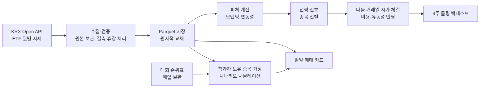

# MT-ETF-King-2026

**제3회 머니투데이 ETF 투자왕 대회를 위해 만든 퀀트 프로젝트: KRX 시세 수집, 미래 정보 없는 백테스트, 대회 순위표 분석, 일일 매매 카드 생성**

[](./pyproject.toml) [](./pyproject.toml) [](./src/core/config.py) [](./src/data/silver.py) [](./tests/)

> [!NOTE]
> 대회는 2026-11-13에 끝나므로 최종 순위와 수상 결과는 적지 않았습니다.
> 아래 수치는 모두 과거 데이터 백테스트(2018-01 ~ 2026-09)이며 실제 대회 성적이 아닙니다.

## 🧭 개요

**대회 개요.** 머니투데이가 여는 ETF 모의투자 대회입니다. 제3회는 2026-09-21부터 11-13까지 8주간 진행되고, 참가자는 코스콤 HTS 기반 모의투자 계정으로 최초 투자금 10억 원을 운용합니다. 전체 수익률 1위에게 대상(1,000만 원)이 주어지고, 후원 운용사의 ETF만 거래할 수 있습니다(출처: 머니투데이 [대회 안내](https://www.mt.co.kr/stock/2026/08/14/2026081416135978575)).

**이 프로젝트가 푸는 문제.** 상금이 상위권에 몰린 8주짜리 대회에서는 평균 수익률보다 "마지막 날 맨 위에 있을 확률"이 중요합니다. 이를 위해 세 가지를 만들었습니다.

- **믿을 수 있는 백테스트:** 시세 수집부터 주문 체결까지, 결정 시점 이후의 정보를 쓰지 못하게 코드로 막았습니다.
- **8주 롤링 검증:** 과거 전 구간을 36거래일(8주) 단위로 하루씩 밀며 잘라, 전략이 8주 만에 +30%를 넘는 비율을 측정합니다.
- **대회 운영 도구:** 매일 공개되는 순위표를 보관하고, 하루 단위 매매 카드를 만들어 줍니다.

## 🏗️ 시스템 구성



- 코드는 `core → data → universe → features → alpha → portfolio → strategies → execution → backtest → tournament / contest → cli` 순서로 한 방향으로만 의존합니다. 이 규칙은 [테스트](./tests/unit/architecture/test_layer_boundaries.py)로 검사합니다.
- 평일 배치는 systemd 타이머([유닛 파일](./deploy/systemd/))가 [셸 스크립트](./scripts/)를 실행하는 방식입니다.

## 🔧 핵심 설계 결정

각 결정을 **문제 → 분석(대안 비교) → 선택 → 결과** 순서로 정리했습니다.

### 🕒 1. 미래 정보 차단: 결정 시점 가드와 다음 시가 체결

- **문제:** 오늘 종가를 보고 오늘 종가에 사는 식으로 백테스트하면 실제로는 불가능한 수익이 나옵니다.
- **분석:** 지표 계산 코드를 사람이 조심해서 쓰는 방식은 실수가 한 번만 나와도 결과 전체가 오염됩니다. 어디서든 실패하는 강제 장치가 필요했습니다.
- **선택:** 결정 날짜보다 뒤의 행이 하나라도 있으면 예외를 던지는 `assert_pit`을 두었고([코드](./src/features/pit.py)), 주문은 신호 다음 거래일 시가에만 체결되게 분리했습니다([체결기](./src/backtest/execution.py)). 거래 없는 날의 가격 처리는 [원장 테스트](./tests/unit/execution/test_ledger_priceless_session.py)로 확인합니다.
- ✅ **결과:** 미래 데이터가 섞이면 조용히 넘어가지 않고 실행이 멈춥니다. "미래 정보 0건" 같은 수치는 따로 측정하지 않았습니다.

### 🧹 2. KRX 시세의 빈 값과 가짜 휴장일 처리

- **문제:** [데이터 분석 문서](./docs/knowledge/mt-data-report.md)에 정리했듯, 값이 없을 때 빈 문자열이 오면 숫자 변환 과정에서 0처럼 취급될 수 있어 수익률이 크게 틀어집니다. 휴장일에도 가격이 빈 레코드가 올 수 있습니다.
- **분석:** 모든 필드를 느슨하게 받으면 이상한 값이 지표로 흘러갑니다. 반대로 너무 엄격하면 하루 데이터가 깨졌을 때 파이프라인이 멈춥니다.
- **선택:** 빈 문자열은 스키마 단계에서 `None`으로 바꿉니다([스키마](./src/data/schema.py)). 그날 종목 가격 중 유효한 비율이 50% 미만이면 휴장일로 분류하고([검증기](./src/data/validation.py)), 거래소 캘린더와 빠진 거래일을 대조합니다.
- ✅ **결과:** 휴장일 판정, 빠진 거래일 탐지, 괴리가 큰 종목의 거래 가능 여부 표시가 [단위 테스트](./tests/unit/data/)로 확인됩니다.

### 📉 3. 급락 직후 현금 도피 문제와 반등 앵커 전략

- **문제:** 기본 전략 `sticky.mom60_raw`는 60일 모멘텀이 마이너스면 현금으로 빠집니다. 그러면 폭락 직후 첫 반등을 놓칠 수 있습니다.
- **분석:** 8주 안에 +30%를 노리는 대회에서는 반등 초입을 놓치는 비용이 큽니다. 반면 반등을 매번 따라 사면 하락장에서 손실이 커집니다.
- **선택:** 60일 모멘텀이 음수여도 20일 모멘텀이 양전환하면 지정 종목(`233740`, `122630`)을 사고, 고점 대비 15% 하락하면 손절하는 `sticky.mom60_post_crash_anchor`를 만들었습니다([설정](./configs/strategies.yaml), [팩토리](./src/strategies/factories/sticky_mom60.py)). 같은 기초지수의 1배·2배·인버스는 한 묶음으로 보고 한 종목만 담습니다([분류기](./src/universe/families.py)).
- ✅ **결과:** 2,097개 롤링 구간에서 8주 +30% 도달 비율이 7.77%로, 기본형(6.78%)보다 높았습니다. 아래 결과 표를 보세요.

### 🎯 4. 순위표 분석: 평균 수익률 대신 상위권 도달 확률

- **문제:** 매일 16:00에 순위표 파일이 덮어써져 과거 이력이 남지 않고, 시상은 상위권에만 있어서 평균 성과로는 의사결정을 하기 어렵습니다.
- **분석:** 남들이 많이 들고 있는 종목을 똑같이 사면 순위를 뒤집을 수 없고, 매일 바꾸면 비용만 듭니다.
- **선택:** 순위표를 날짜별로 덧붙이기만 하는 보관소로 저장하고([코드](./src/contest/leaderboard.py)), 참가자 1,268명([설정](./configs/contest.yaml))의 보유 종목 분포를 가정한 시뮬레이션으로 후보별 1위 확률을 비교합니다([엔진](./src/contest/engine.py), [의사결정](./src/contest/decision.py)). 설정상 4개 기간 × 2개 프로필 조합마다 8,000개 시나리오를 만들고, 1위 확률이 5%p 이상 높아질 때만 포지션을 바꿉니다.
- ✅ **결과:** 의사결정 도구로 구현되어 있고 [테스트](./tests/unit/contest/)가 있습니다. 참가자 분포는 가정값이라 이 확률 자체를 검증하지는 못했습니다(한계 참고).

### 🔁 5. 하이닉스 2배 상품: 밤샘 보유와 장중 전환

- **문제:** 레버리지 상품의 수익은 밤사이 갭과 장중 움직임으로 나뉘는데, 둘의 성격이 다릅니다.
- **분석:** 코드 설명([segment.py](./src/contest/segment.py))은 반도체 계열의 장중 수익률이 전날 움직임과 반대로 가는 경향이 있고 밤사이에는 양의 방향이 있다는 가정에 기댑니다. 이 가정을 뒷받침하는 검증 수치는 아직 없습니다.
- **선택:** 하이닉스 2배(`0193T0`)를 밤새 보유합니다. 장중에는 전날 종가 기준으로 하이닉스 2배·반도체 2배·코스피200 2배 중 2개 이상이 하락했으면 롱을 유지하고, 아니면 하이닉스 인버스 2배(`0197X0`)로 바꿉니다. 주문은 동시호가를 피해 09:05~09:15, 15:10~15:19에만 냅니다. 데이터가 빠지면 주문 없이 롱을 유지합니다.
- ✅ **결과:** 순수 함수와 [테스트](./tests/unit/contest/test_segment.py)로 구현되어 매일 카드를 만듭니다. 이 정책의 백테스트 수익률 결과는 없습니다.

## 📊 결과

2018-01-02 ~ 2026-09-10 일별 데이터를 36거래일 구간으로 하루씩 밀며 잘라 본 **재현 시뮬레이션** 결과입니다. 비용·슬리피지가 반영되며 실계좌 수익이 아닙니다. 전략별로 전체 구간을 돌린 마지막 실행 기록이며, 원본은 [`runs_registry.jsonl`](./docs/results/runs_registry.jsonl)입니다.

| 전략 | 구간 수 | 8주 +30% 이상 비율 | 상위 5% 구간 수익률 | 하위 5% 평균 손실(CVaR) |
| :--- | :---: | :---: | :---: | :---: |
| `sticky.mom60_post_crash_anchor` | 2,097 | 7.77% | +43.85% | -21.56% |
| `sticky.mom60_raw` | 2,095 | 6.78% | +49.51% | -23.16% |
| `baseline.mom20_top1` | 2,088 | 3.83% | +21.88% | -24.78% |
| `baseline.buy_hold` | 2,088 | 2.54% | +21.01% | -15.09% |

- 구간 수가 다른 것은 실행 시점에 데이터의 마지막 날짜가 달랐기 때문이라, 완전히 같은 조건의 비교는 아닙니다.
- 반등 앵커 전략은 +30% 비율은 높지만 상위 5% 수익률은 기본형보다 낮습니다.
- [`champion_promotion.json`](./docs/results/champion_promotion.json)의 승격 판정은 `RESEARCH_ONLY`(채택 기준 미통과)입니다. 이 표의 전략이 대회 운용 전략으로 확정됐다는 뜻이 아닙니다.

## ⚠️ 한계

- 위 수치는 과거 데이터 백테스트이며 미래 성과를 보장하지 않습니다. 대회 성적은 대회가 끝난 뒤 따로 확인해야 합니다.
- 구간이 하루씩 밀려 서로 크게 겹치므로 2,000여 개 구간은 독립 표본이 아닙니다. 실질 표본 수는 훨씬 적습니다.
- 순위 시뮬레이션의 참가자 분포(인기 종목 비율 등)는 [설정](./configs/contest.yaml)에 넣은 가정입니다.
- 일부 레버리지·인버스 상품은 기초지수 배수로 합성해 계산하므로 실제 상품의 추적오차와 다를 수 있습니다.
- 모의투자 대회라 체결 방식과 호가 영향이 실제 시장과 다를 수 있습니다.

## 🧱 기술 스택

| 구분 | 사용 기술 |
| :--- | :--- |
| 언어·환경 | Python 3.11, uv |
| 데이터 | Polars, PyArrow(Parquet), exchange-calendars |
| 수집 | httpx, tenacity(재시도) |
| 검증·설정 | Pydantic v2, PyYAML |
| 품질 | pytest, Ruff, Mypy([통합 검증 스크립트](./tools/verify.py)) |
| 운영 | systemd 타이머, 셸 스크립트 |

## 📂 프로젝트 구조

```text
configs/            # YAML 설정 (대회 규칙, 전략 파라미터, 유니버스)
src/
├── core/           # 설정, 캘린더, 원자적 파일 저장
├── data/           # KRX 수집, 시세 스키마, 검증, Parquet 저장
├── universe/       # 투자 가능 ETF 선별, 같은 기초지수 묶음 분류
├── features/       # 결정 시점 가드(assert_pit), 지표 계산
├── alpha/          # 모멘텀 기반 점수와 신호
├── portfolio/      # 종목 선별, 비중 계산
├── strategies/     # 전략 등록과 팩토리
├── execution/      # 포지션 원장
├── backtest/       # 다음 시가 체결, 비용, 유동성 한도
├── tournament/     # 8주 롤링 백테스트
├── contest/        # 순위표 보관, 참가자 시뮬레이션, 일일 매매 카드
└── cli/            # mt-etf 명령
tests/              # unit, integration (unit/architecture 에 구조 검사)
tools/verify.py     # Ruff + Mypy + pytest 한 번에 실행
scripts/, deploy/   # 평일 배치 스크립트, systemd 유닛
docs/               # 데이터 분석 문서, 백테스트 결과 기록
```

## 🚀 시작하기

KRX Open API 인증키가 필요하며 저장소에는 포함되어 있지 않습니다([설정 코드](./src/core/settings.py)의 `krx_openapi_key`).

```bash
uv sync --all-extras                       # 의존성 설치 (Python 3.11)
uv run python tools/verify.py              # 린트·타입·테스트 한 번에
uv run mt-etf config-check                 # 설정 검증
uv run mt-etf daily-refresh                # 수집 → 정규화 → 피처 일일 배치
uv run mt-etf backtest --model sticky.mom60_post_crash_anchor --start 2018-01-02 --end 2026-09-10
uv run mt-etf contest-segment              # 하루 구간 매매 카드
```

## 🤖 개발 과정에서의 AI 활용

AI 도구는 주로 코드 작성에 사용했고, 아이디어를 정리하거나 ETF·대회 도메인을 공부하는 데도 썼습니다. **수치와 동작은 직접 확인했습니다.**

| AI에 맡긴 일 | 직접 한 일 |
| :--- | :--- |
| 코드 작성 | 결과 수치와 동작 검증 |
| 아이디어 정리, 도메인 학습 보조 | 전략·대회 운영에 대한 판단 |

## 📚 참고

- 제3회 ETF투자왕 대회 안내: [머니투데이](https://www.mt.co.kr/stock/2026/08/14/2026081416135978575)
- KRX 시세 데이터 분석 문서: [`docs/knowledge/mt-data-report.md`](./docs/knowledge/mt-data-report.md)
